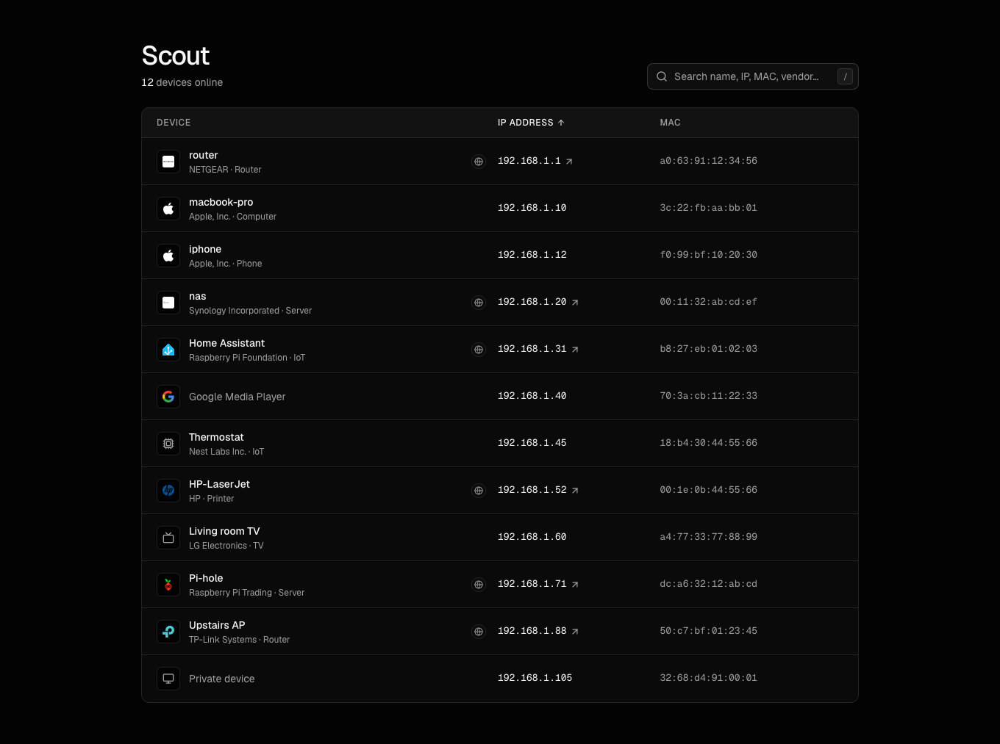

# Scout

A minimal, self-hosted LAN scanner. It runs as one Go binary with an embedded dashboard that lists the devices on your network right now, one row per device, with no logins and no settings pages. It rescans every 60 seconds and drops a device after it misses two scans in a row.



Scout is a fork of [LAN Orangutan](https://github.com/291-Group/LAN-Orangutan) by 291 Group. The scanner (nmap, mDNS, NetBIOS, vendor lookup, device classification) comes from upstream. Scout replaces the web UI.

## Run with Docker (Linux)

```yaml
services:
  scout:
    image: ghcr.io/timblazing/scout:latest
    container_name: scout
    restart: unless-stopped
    network_mode: host
    cap_add: [NET_RAW, NET_ADMIN, NET_BIND_SERVICE]
    environment:
      - ORANGUTAN_PORT=291
      - TZ=America/Chicago
    volumes:
      - ./data:/var/lib/lan-orangutan
```

Open `http://<host>:291`. Host networking is required, so this won't work under Docker Desktop on macOS or Windows.

Click a device name to rename it, then press Enter or click away to save. Click its icon to choose a device icon or search the Dashboard Icons collection. Names and icon choices are saved in `names.json` under `ORANGUTAN_DATA_DIR` (`./data/names.json` with the Compose volume above) and survive scans and restarts. Names are keyed by MAC address. An existing `devices.json` from an earlier version is imported once the first time Scout starts, then left alone. Scout also matches known vendor and device names to Dashboard Icons automatically; manual choices take precedence. Brand icons load from the [Dashboard Icons jsDelivr CDN](https://github.com/homarr-labs/dashboard-icons#direct-links), so they need browser internet access. Scout falls back to a device icon if an image cannot load.

> The dashboard has no authentication. Anyone who can reach the port can see your devices and rename them. Keep it on a trusted network, or put a reverse proxy with auth in front of it.

The image runs as root for raw network discovery. Pre-creating `./data` with
your user as owner prevents Docker from creating the directory as root, but
`names.json` is still written by the container as root with owner-only access.
`PUID` and `PGID` are not supported.

## Configuration

Configuration comes from environment variables, or from `config.ini` (see `config.example.ini`).

| Variable | Default | |
|---|---|---|
| `ORANGUTAN_PORT` | `291` | HTTP port |
| `ORANGUTAN_BIND_ADDRESS` | `0.0.0.0` | Listen address |
| `ORANGUTAN_NETWORKS` | auto-detect | Extra CIDRs to scan, comma separated |
| `ORANGUTAN_EXCLUDE_NETWORKS` | | CIDRs to skip |
| `ORANGUTAN_ONLY_CONFIGURED_NETWORKS` | `false` | Scan only `ORANGUTAN_NETWORKS` |
| `ORANGUTAN_SCAN_INTERVAL` | `60` | Seconds between scans |
| `ORANGUTAN_ENABLE_SERVICE_DETECTION` | `false` | Probe ports to flag web UIs and risky services |
| `ORANGUTAN_DATA_DIR` | `/var/lib/lan-orangutan` | Saved device names and icons |

The `ORANGUTAN_*` names and the data path are kept from upstream. Tailscale addresses (100.64.0.0/10) and single-address networks are never scanned.

## Development

The project needs Go 1.25+, Node 22+, and nmap.

```sh
make web                              # build the dashboard into internal/web/dist
go run ./cmd/orangutan serve          # serve it on :291 (sudo for ARP/MACs)

make web-dev                          # hot-reloading UI on :5173, proxies /api to :291
SCOUT_API=http://10.0.0.5:291 make web-dev   # or proxy to a remote instance
```

| Path | Contents |
|---|---|
| `web/` | Vite + React + TypeScript + Tailwind v4 + shadcn/ui |
| `internal/web/` | Embeds and serves the built dashboard |
| `internal/api/` | JSON API; the dashboard polls `GET /api/devices` and saves names with `PATCH /api/devices/{id}` |
| `internal/scanner/`, `internal/network/` | Discovery (upstream) |

The searchable Dashboard Icons catalog is bundled with the frontend and loads on demand, so searching works without contacting GitHub. Run `python3 scripts/update-dashboard-icons.py` to refresh it from the upstream metadata and file list, then rebuild the dashboard. The icons remain hosted by Dashboard Icons and are licensed under [Apache 2.0](https://github.com/homarr-labs/dashboard-icons/blob/main/LICENSE).

## Releasing

Each push to `main` runs CI, then publishes a multi-arch image to `ghcr.io/<owner>/scout:latest` and a `sha-<commit>` tag after all checks pass. Push a `v*` tag to build versioned binaries and publish a versioned image. Releases include native binary archives and a Linux installer bundle; distro packages and package-manager manifests are not published. After the first publish, set the package to public under GitHub → Packages → scout → Settings, or run `docker login ghcr.io` on the host.

## License

MIT. See [LICENSE](LICENSE). Original work © 291 Group.
